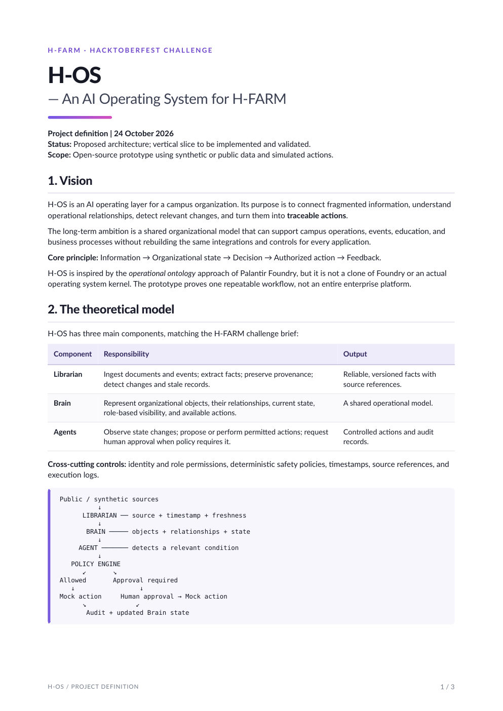
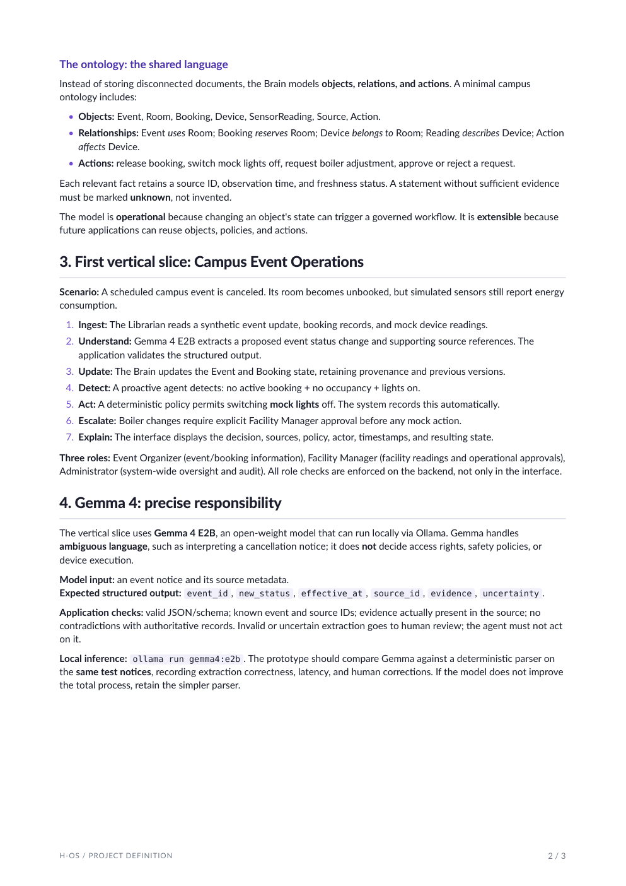
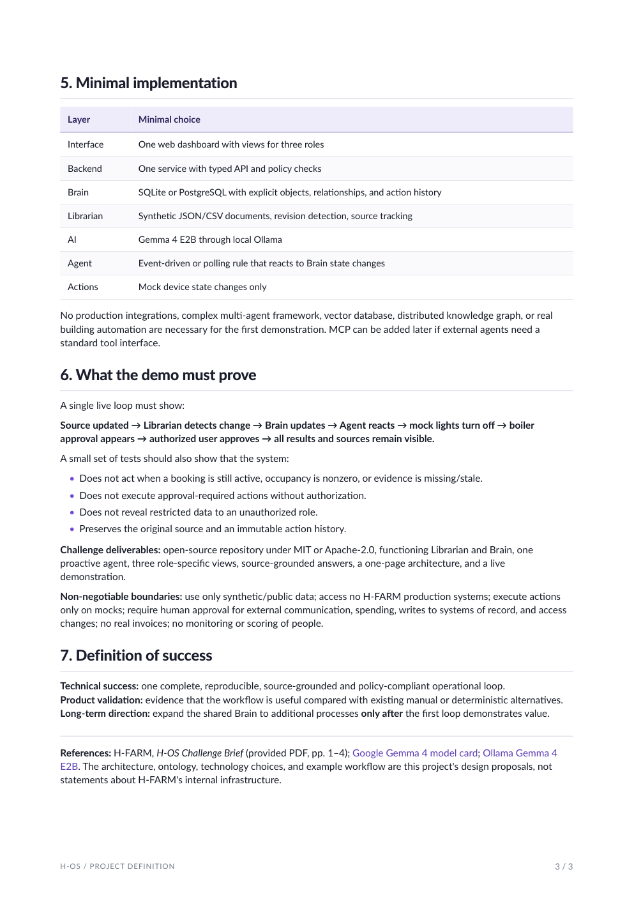

# loop-closers-hos-event-system
An event intelligence system connecting fragmented information across H-FARM entities into a unified operational view.

## Project definition

[Download the H-OS canonical project (PDF)](docs/H-OS_Canonical_Project.pdf)

